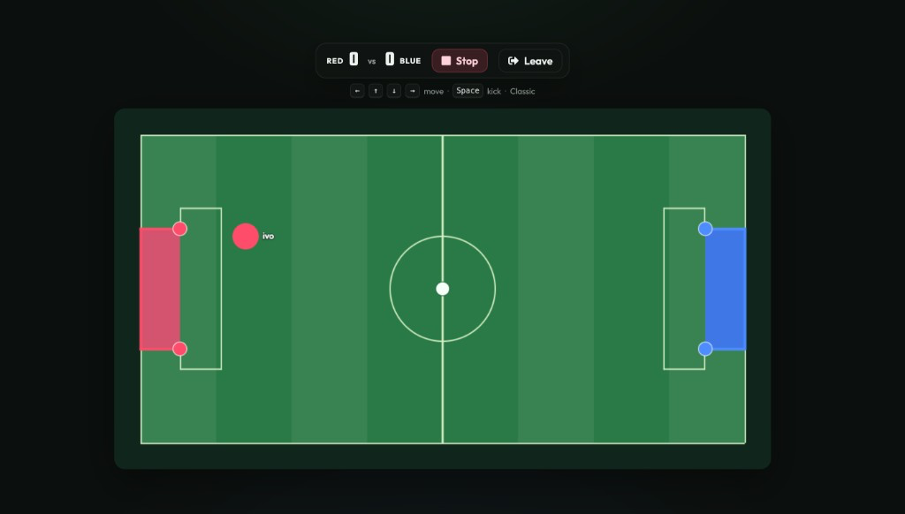

<h1>Open-source <a href="https://www.haxball.com/" target="_blank">Haxball</a> clone</h1>


Browser 2D football. Host a match, share a link, play in the same tab.

Play at https://ivo-.github.io/open-haxball/

## How to play

1. Pick a name.
2. **Create match**, or paste an invite link to join.
3. Host: assign teams, pick a map (Classic or Hockey), copy the invite link, then **Start match**.
4. Arrow keys to move, Space to kick.

First to 5 goals wins. Start again to reset the score and positions. Leave to go back to the home screen.

Physics is still noticeably different from Haxball. Expect glitches.

## Run locally

```sh
npm install
npm run dev
```

Built with [Vite](https://vitejs.dev/), [Alpine.js](https://alpinejs.dev/), [matter.js](https://github.com/liabru/matter-js), and [peer.js](https://github.com/peers/peerjs).
